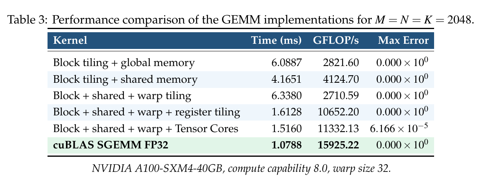
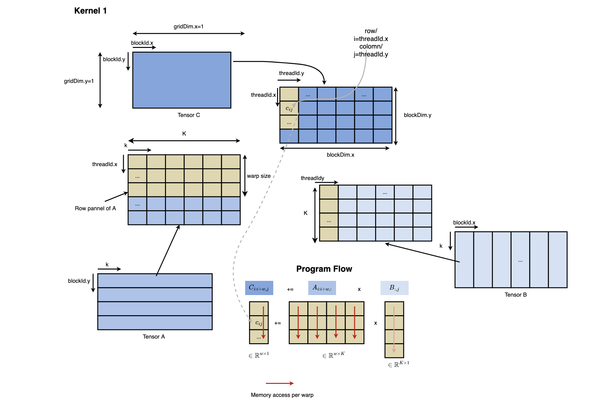
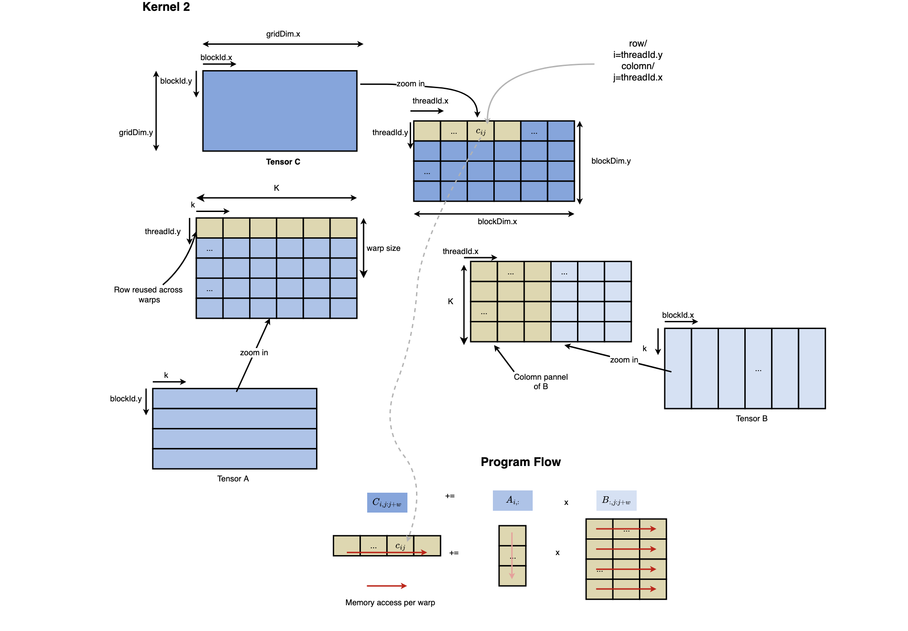
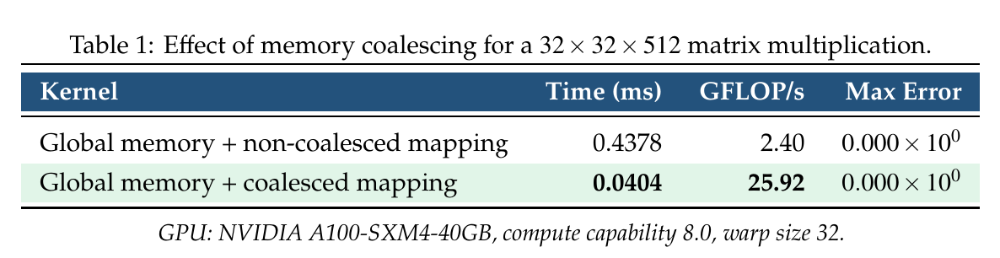
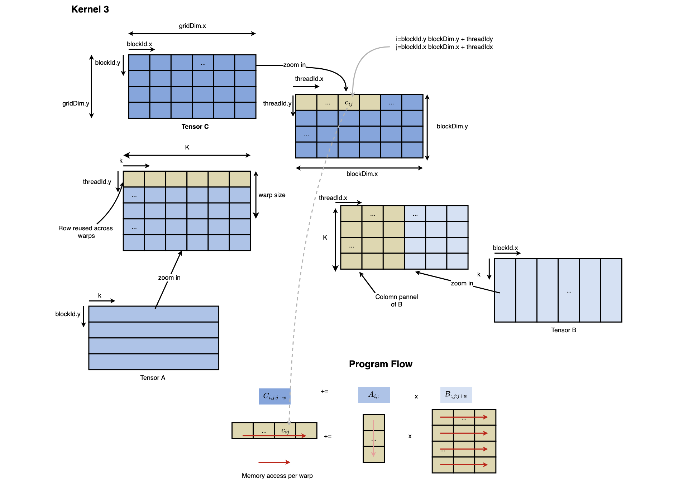
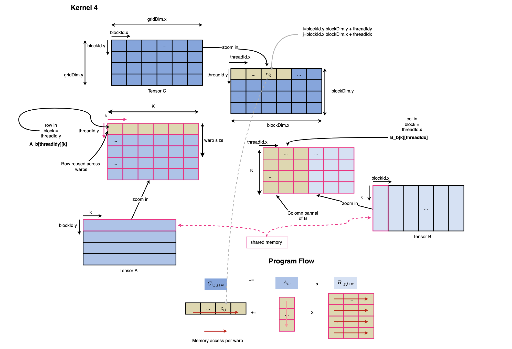
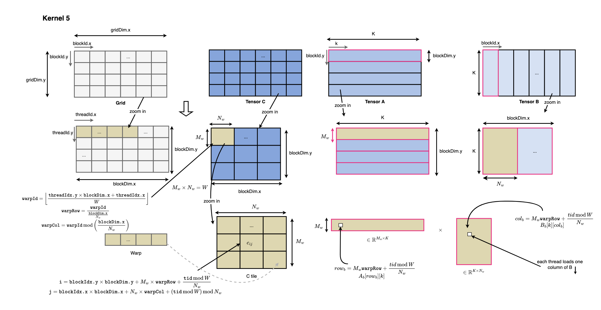
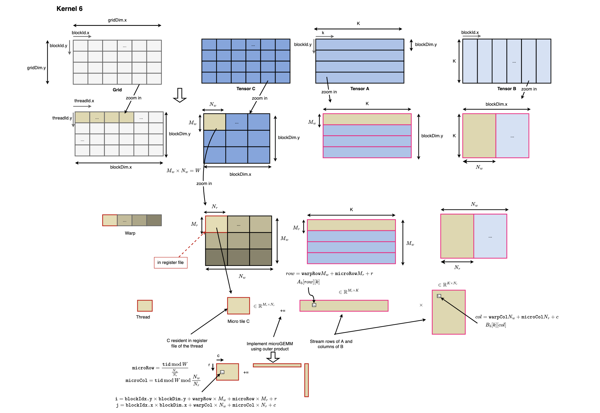
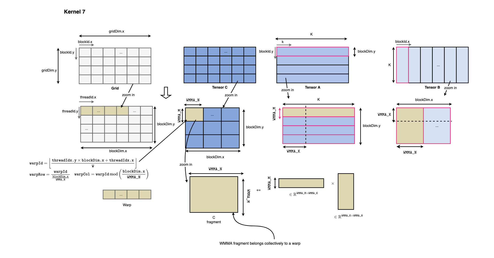
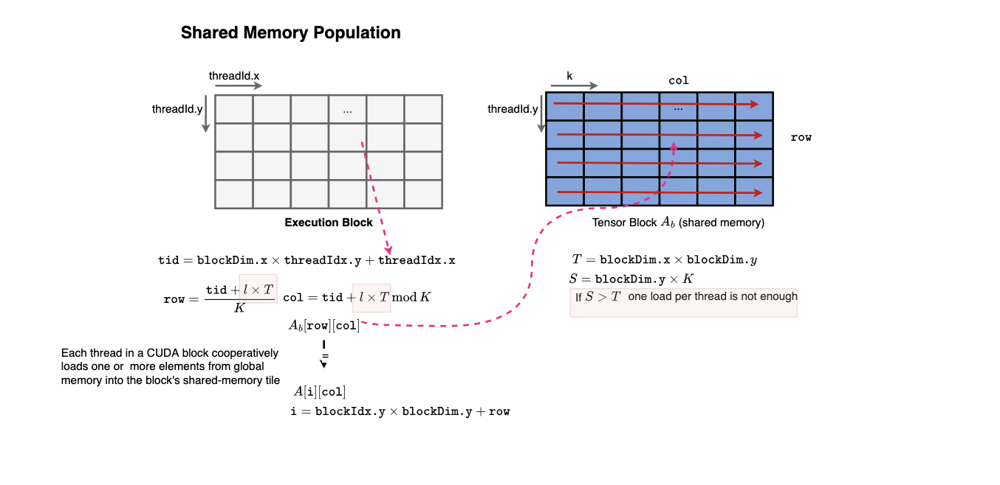

# GEMM using GPU/CUDA

This project provides an educational implementation of General Matrix Multiplication (GEMM) in CUDA, progressively exploring memory coalescing, block and warp tiling, shared memory, register tiling, and Tensor Core acceleration, with performance comparisons against cuBLAS.

The primary goal is to develop a deeper understanding of GPU architecture, CUDA programming, and the design and optimization of high-performance GPU kernels.

This is an ongoing learning project and will be actively extended and refined as I continue exploring GPU programming and optimization techniques.




### Related Material

For a more detailed discussion of the concepts:

- Short Post: 
- Technical Notes (GPU section):

Compile the CUDA source code using `nvcc`:

```bash
nvcc -O3 -std=c++17 -arch=sm_80 gemm.cu -lcublas -o gemm
```

Run the executable:

```bash
./gemm
```

The following results were obtained on an NVIDIA A100-SXM4-40GB GPU:

```text
GPU: NVIDIA A100-SXM4-40GB
Compute capability: 8.0
Warp size: 32

============================================================
PART A: SMALL MATRIX -- ONE BLOCK
M = 32, N = 32, K = 512
============================================================

Kernel                                                            Time(ms)         GFLOP/s         Max Error    Status
----------------------------------------------------------------------------------------------------------------------
1. Global memory + bad/non-coalesced mapping                        0.4137            2.53         0.000e+00      PASS
2. Global memory + coalesced mapping                                0.0384           27.31         0.000e+00      PASS


============================================================
PART B: LARGE MATRIX
M = 2048, N = 2048, K = 2048
============================================================

Computing GPU FP32 ground truth...
Ground truth complete.


============================================================
LARGE MATRIX RESULTS
============================================================

Kernel                                                            Time(ms)         GFLOP/s         Max Error    Status
----------------------------------------------------------------------------------------------------------------------
3. Block tiling + global memory                                     5.7764         2974.16         0.000e+00      PASS
4. Block tiling + shared memory                                     3.9480         4351.50         0.000e+00      PASS
5. Block + shared + warp tiling                                     6.0462         2841.43         0.000e+00      PASS
6. Block + shared + warp + register tiling                          1.5411        11147.65         0.000e+00      PASS
7. Block + shared + warp + Tensor Cores                             1.4566        11794.18         6.166e-05      PASS
10. cuBLAS SGEMM FP32                                               1.0301        16677.15         0.000e+00      PASS
```

There is a lot of room for improvement, and you can experiment yourself to get even closer to cuBLAS, or why not better. This was not the goal of this project.

### Kernel 1

Illustrates a bad memory access pattern, where the memory traffic generated is large due to non-coalesced accesses, as each thread in a warp accesses non-consecutive memory locations.



### Kernel 2

Fixes the memory access pattern experienced in Kernel 1 and improves performance. Both Kernel 1 and Kernel 2 operate on a very small matrix to illustrate the importance of memory access patterns.






### Kernel 3

Uses block tiling and a good memory access pattern, albeit using global memory for now.



### Kernel 4

Uses block tiling, but this time with shared memory, which enables higher arithmetic intensity as the memory traffic generated is smaller. Shared memory is dedicated to the warps in the block and is not subject to cache eviction or capacity/conflict misses.




### Kernel 5

Uses block tiling + warp tiling + shared memory. This does not necessarily improve performance, but serves as a step toward Kernel 6 by enabling each warp to handle a tile of the output.



### Kernel 6

Uses block tiling + warp tiling + register tiling + shared memory, where each thread handles a micro-tile of the output. The C micro-tile remains resident in registers, while rows and columns of the other operands, A and B, are loaded into registers to perform outer products, enabling higher register reuse.



### Kernel 7

Uses block tiling + warp tiling + shared memory + Tensor Cores. This kernel uses Tensor Cores to load fragments of the operands and perform matrix multiplication using tensor units.




### Shared Memory Population

For shared memory, each thread in a CUDA block needs to be responsible for loading one or more tensor elements from global memory into the corresponding shared-memory locations. This can be achieved as illustrated below, where we linearize the execution block using a thread identifier tid and navigate the shared-memory tile using this linear index. If the shared-memory tile contains more elements than the number of threads in the block, each thread performs multiple loads with a stride equal to the total number of threads in the block. This allows all threads in the block to cooperatively populate the shared-memory tile before computation begins.



